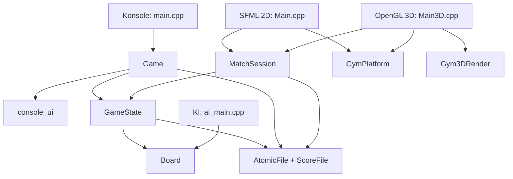

# Architektur der Gym Edition

C++17 mit optionalen SFML-, OpenGL- und KI-Erweiterungen. Die praktische Abnahme dieses Entwicklungsstands steht aus.

## Vier ausführbare Programme

| Programm | Einstieg | Steuerung | Darstellung |
|:--|:--|:--|:--|
| `vier-gewinnt` | `src/main.cpp` | `Game` | Konsole, SFML-frei |
| `vier-gewinnt-gui` | `src/gui/Main.cpp` | `App` + `MatchSession` | SFML Graphics/Audio 3.1.0 |
| `vier-gewinnt-3d` | `src/gui/Main3D.cpp` | `Arena3D` + `MatchSession` | SFML und OpenGL-Kompatibilitätsprofil |

| `vier-gewinnt-ki` | `src/ai_main.cpp` | `AiConsoleGame` | Separater Konsolenmodus ohne dauerhafte Highscores |

`Board` implementiert die Spielfeldregeln. `Game` steuert die Konsole; `MatchSession` verwaltet den Zustand für 2D und 3D. Beide verwenden `GameState.h` für Zugfolge, Undo, Namensprüfung und GYM1-Spielstände. Der KI-Modus verwendet `Board` mit eigener Sitzungsbilanz. `AtomicFile.h` und `ScoreFile.h` sichern die Dateiablage.

`GymPlatform.h` enthält die gemeinsame SFML-Systemschrift und den Unicode-sicheren Windows-Executable-Pfad für die 2D-Variante. `Gym3DRender.h` kapselt klassische OpenGL-Primitiven ohne Spiellogik. Die 3D-Version nutzt absichtlich noch ein Kompatibilitätsprofil, keine moderne Shader-/PBR-Pipeline.

## Verantwortlichkeiten und Beziehungen

| Baustein | Wichtige Daten | Wesentliche Methoden und Funktionen |
|:--|:--|:--|
| `Board` | `rows_`, `columns_`, `grid_` | `nextFreeRow`, `drop`, `undo`, `hasWon`, `winningCells`, `isFull` |
| `Player` | Name, Symbol | `getName`, `getSymbol` |
| `Game` | Ein Board, 2–4 Player, `vector<Move>`, Highscore-Map, Rundenzustand | `run`, `newGame`, `play`, `rematch`, `saveGame`, `loadGame` |
| `MatchSession` | Ein Board, 2–4 Player, `vector<GymMove>`, Score-Map, Gewinnlinie | `begin`, `drop`, `undo`, `rematch`, `save`, `load`, `saveScores` |
| `GameState.h` | `gym::Move`, `SavedGame` | `playMove`, `undoMove`, `readGame`, `writeGame`, `validPlayerName` |
| `console_ui` | Darstellungsfunktionen und Ansichtsdaten | `arena`, `present`, `result`, `animateDrop` |
| `App` | 2D-Fenster, Schullogo, `MatchSession`, optionaler `GymBeat` | Ereignisschleife, `act`, `move`, `render`, `toggleMusic` |
| `Arena3D` | 3D-Kamera, Fenster, `MatchSession`, optionaler `GymBeat` | Kamera, Benutzeraktionen und Szenenaufbau |
| `GymPlatform` | Schrift- und Unicode-Pfadintegration | `systemFont`, `executablePath` |
| `Gym3DRender` | OpenGL-Grundformen | `cube`, `disc`, `ring`, `cameraGL` |
| `GymBeat` | SoundBuffer, danach erzeugter Sound | Töne erzeugen, `play`, `stop`, `playing` |
| `gym::writeSafely` | Individueller temporärer Dateipfad | Vollständig schreiben, prüfen und vorhandene Datei ersetzen |
| `gym::parseScores` | Highscore-Datei | Vollständig validieren, ohne halbe Ergebnisse zu übernehmen |

`Game` und `MatchSession` besitzen jeweils ihr Board und ihre Spieler. Es gibt kein gemeinsames, gleichzeitig benutztes Board-Objekt zwischen zwei gestarteten Programmen. `Player` enthält keinen Siegstand. Siege stehen in `Game::highscores_` beziehungsweise `MatchSession::scores_`.

## Ein gültiger Spielzug

Die Oberfläche wandelt eine Spaltenauswahl in einen nullbasierten Index um. `Board::nextFreeRow` sucht von unten nach Platz. `Board::drop` setzt ein Symbol. `gym::playMove` merkt sich den Zug, prüft `hasWon`, danach `isFull` und wechselt bei weiterlaufender Partie den Spieler. Ungültige Züge ändern weder Raster noch Zugfolge.

In der GUI berechnet `App` zunächst die Zielzeile und zeigt bei aktiver Animation eine fallende Hantel. Erst nach dem Fall übernimmt `MatchSession::drop` den Zug in den Spielzustand. Währenddessen blockiert die GUI weitere Spielaktionen. Die Konsole erzeugt ihre Animationsbilder in `console_ui`, ohne eine Grafikbibliothek zu benötigen.

## Gewinnerkennung

`Board::hasWon` zählt vom letzten Stein aus waagerecht, senkrecht sowie entlang beider Diagonalen. Jede Achse wird in beide Richtungen untersucht. Die Länge enthält den neuen Stein nur einmal. Ab vier zusammenhängenden Symbolen liegt ein Sieg vor. `winningCells` liefert die zu markierenden Koordinaten. Bei einer längeren zusammenhängenden Gewinnlinie können mehr als vier Felder markiert werden.

## Speichern und Laden

Konsole, 2D und 3D verwenden `data/savegame.txt` im Format `GYM1` und `data/highscore.txt`. Ein Spielstand enthält Spielerzahl, aktuellen Spieler, Abmessungen, Namen, Symbole, Zugfolge und Raster. `gym::readGame` baut zuerst einen geprüften Kandidaten auf. Erst nach erfolgreichen Prüfungen ersetzt er den laufenden Zustand.

`gym::writeSafely` schreibt zuerst eine temporäre Datei im Zielordner. Unter Windows ersetzt `MoveFileExW` das Ziel, unter anderen unterstützten Systemen `std::filesystem::rename`. Tests prüfen auch blockierte Temp-Dateien. Temporäre Dateien verwenden nun einen eindeutigen Suffix; die zuvor geteilte `.tmp`-Datei blockiert andere Aufrufe nicht mehr. `gym::parseScores` in `include/ScoreFile.h` prüft Highscore-Datensätze streng und verwirft die komplette Liste bei kaputten, doppelten oder abgeschnittenen Einträgen. Ein Datei-Ersatz ist **keine** Transaktion zwischen gleichzeitig gestarteten Spielinstanzen und garantiert nicht in allen Situationen vollständige Stromausfallsicherheit. Gleichzeitige Prozesse werden nicht durch eine Sperrdatei koordiniert. Der Demonstrationsstarter führt GUI und Konsole deshalb nacheinander aus.

## Grenzen und offene Arbeiten

- Das `GYM1`-Format speichert keine laufende Revanche-Rundennummer. Nach dem Laden beginnt die Anzeige bei Runde 1.
- Das 24-Byte-Limit für Namen ist bei UTF-8 nicht gleichbedeutend mit 24 sichtbaren Buchstaben.
- Zugverwaltung und GYM1-Validierung sind gemeinsam. Menüs, Rundensteuerung und Highscore-Fehlerbehandlung bleiben getrennt.
- Es gibt keine eigenständige 3D-Engine und keinen Netzwerkmodus. Der KI-Gegner ist ein optionaler Konsolenmodus.
- Interaktive Zielgeräteprüfung und Unterrichtserklärung stehen noch aus.

Weitere Belege: [Entwicklungsprotokoll](DEVELOPMENT_LOG_2026-10-28.md), [Qualität](QUALITY_AND_TESTS.md), [GUI-Testplan](GUI_TESTPLAN.md).
