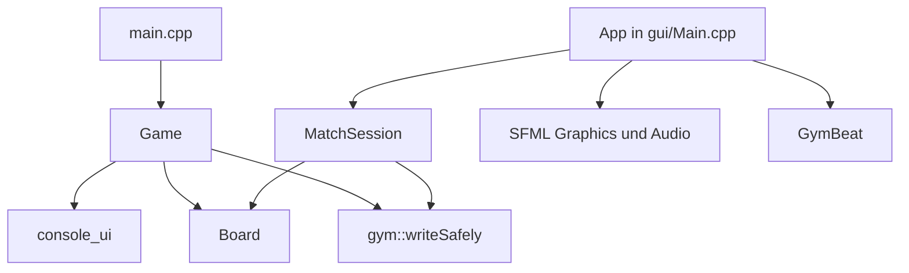

# Architektur der Gym Edition

**Stand:** 28.10.2026 · **Basis:** C++17, optionale SFML-3.1.0-GUI
Quellcodeabgleich: `include/` und `src/` am Commit `02eb79f8`.

## Zwei ausführbare Programme

| Programm | Einstieg | Steuerung | Darstellung | Zusätzliche Abhängigkeit |
|:--|:--|:--|:--|:--|
| `vier-gewinnt` | `src/main.cpp` | `Game` | Funktionen im Namensraum `console_ui` | Keine SFML-Abhängigkeit |
| `vier-gewinnt-gui` | `src/gui/Main.cpp` | `App` und `MatchSession` | SFML-Fenster, Texte, Hanteln, Schaltflächen | SFML Graphics und Audio 3.1.0 |

Die Konsole verwendet nicht `MatchSession`. Sie behält ihren bestehenden Controller `Game`. Die GUI nutzt eine eigene, ohne SFML testbare `MatchSession`. Das gemeinsame `Board` stellt die Regeln bereit. `AtomicFile.h` enthält die gemeinsame Datei-Hilfsfunktion. Das verhindert eine falsche Aussage über eine bereits vollständig vereinheitlichte Spielflussarchitektur.

## Verantwortlichkeiten und Beziehungen

| Baustein | Wichtige Daten | Wesentliche Methoden und Funktionen |
|:--|:--|:--|
| `Board` | `rows_`, `columns_`, `grid_` | `nextFreeRow`, `drop`, `undo`, `hasWon`, `winningCells`, `isFull` |
| `Player` | Name, Symbol | `getName`, `getSymbol` |
| `Game` | Ein Board, 2–4 Player, `vector<Move>`, Highscore-Map, Rundenzustand | `run`, `newGame`, `play`, `rematch`, `saveGame`, `loadGame` |
| `MatchSession` | Ein Board, 2–4 Player, `vector<GymMove>`, Score-Map, Gewinnlinie | `begin`, `drop`, `undo`, `rematch`, `save`, `load`, `saveScores` |
| `Move` und `GymMove` | `row`, `column`, `player` | Öffentliche Datenstrukturen für die jeweilige Historie |
| `console_ui` | Darstellungsfunktionen und Ansichtsdaten | `arena`, `present`, `result`, `animateDrop` |
| `App` | Fenster, Schrift, Schullogo, `MatchSession`, optionaler `GymBeat` | Ereignisschleife, `act`, `move`, `render`, `toggleMusic` |
| `GymBeat` | SoundBuffer, danach erzeugter Sound | Töne erzeugen, `play`, `stop`, `playing` |
| `gym::writeSafely` | Individueller temporärer Dateipfad | Vollständig schreiben, prüfen und vorhandene Datei ersetzen |
| `gym::parseScores` | Highscore-Datei | Vollständig validieren, ohne halbe Ergebnisse zu übernehmen |

`Game` und `MatchSession` besitzen jeweils ihr Board und ihre Spieler. Es gibt kein gemeinsames, gleichzeitig benutztes Board-Objekt zwischen zwei gestarteten Programmen. `Player` enthält keinen Siegstand. Siege stehen in `Game::highscores_` beziehungsweise `MatchSession::scores_`.

## Ein gültiger Spielzug

Die Oberfläche wandelt eine Spaltenauswahl in einen nullbasierten Index um. `Board::nextFreeRow` sucht von unten nach Platz. `Board::drop` setzt ein Symbol. Der Controller merkt sich den Zug, prüft `hasWon`, danach `isFull` und wechselt bei weiterlaufender Partie den Spieler. Ungültige Züge ändern weder Raster noch Zugfolge.

In der GUI berechnet `App` zunächst die Zielzeile und zeigt bei aktiver Animation eine fallende Hantel. Erst nach dem Fall übernimmt `MatchSession::drop` den Zug in den Spielzustand. Währenddessen blockiert die GUI weitere Spielaktionen. Die Konsole erzeugt ihre Animationsbilder in `console_ui`, ohne eine Grafikbibliothek zu benötigen.

## Gewinnerkennung

`Board::hasWon` zählt vom letzten Stein aus waagerecht, senkrecht sowie entlang beider Diagonalen. Jede Achse wird in beide Richtungen untersucht. Die Länge enthält den neuen Stein nur einmal. Ab vier zusammenhängenden Symbolen liegt ein Sieg vor. `winningCells` liefert die zu markierenden Koordinaten. Bei einer längeren zusammenhängenden Gewinnlinie können mehr als vier Felder markiert werden.

## Speichern und Laden

Beide Programme verwenden `data/savegame.txt` im Format `GYM1` und `data/highscore.txt`. Ein Spielstand enthält Spielerzahl, aktuellen Spieler, Abmessungen, Namen, Symbole, Zugfolge und Raster. Beim Laden entsteht zuerst ein geprüfter Kandidat. Erst nach erfolgreichen Prüfungen ersetzt er den laufenden Zustand.

`gym::writeSafely` schreibt zuerst eine temporäre Datei im Zielordner. Unter Windows ersetzt `MoveFileExW` das Ziel, unter anderen unterstützten Systemen `std::filesystem::rename`. Tests prüfen auch blockierte Temp-Dateien. Temporäre Dateien verwenden nun einen eindeutigen Suffix; die zuvor geteilte `.tmp`-Datei blockiert andere Aufrufe nicht mehr. `gym::parseScores` in `include/ScoreFile.h` prüft Highscore-Datensätze streng und verwirft die komplette Liste bei kaputten, doppelten oder abgeschnittenen Einträgen. Ein Datei-Ersatz ist **keine** Transaktion zwischen gleichzeitig gestarteten Spielinstanzen und garantiert nicht in allen Situationen vollständige Stromausfallsicherheit. Gleichzeitige Prozesse werden nicht durch eine Sperrdatei koordiniert. Der Demonstrationsstarter führt GUI und Konsole deshalb nacheinander aus.

## Grenzen und offene Arbeiten

- Das `GYM1`-Format speichert keine laufende Revanche-Rundennummer. Nach dem Laden beginnt die Anzeige bei Runde 1.
- Das 24-Byte-Limit für Namen ist bei UTF-8 nicht gleichbedeutend mit 24 sichtbaren Buchstaben.
- Board und Dateiersatz sind gemeinsam. Menüsteuerung und Teile der Persistenzvalidierung bestehen weiterhin in zwei Controllern.
- Es gibt keine 3D-Engine, keinen KI-Gegner und keinen Netzwerkmodus.
- Interaktive Zielgeräteprüfung und Unterrichtserklärung stehen noch aus.

Weitere Belege: [Entwicklungsprotokoll](DEVELOPMENT_LOG_2026-10-28.md), [Qualität](QUALITY_AND_TESTS.md), [GUI-Testplan](GUI_TESTPLAN.md).
