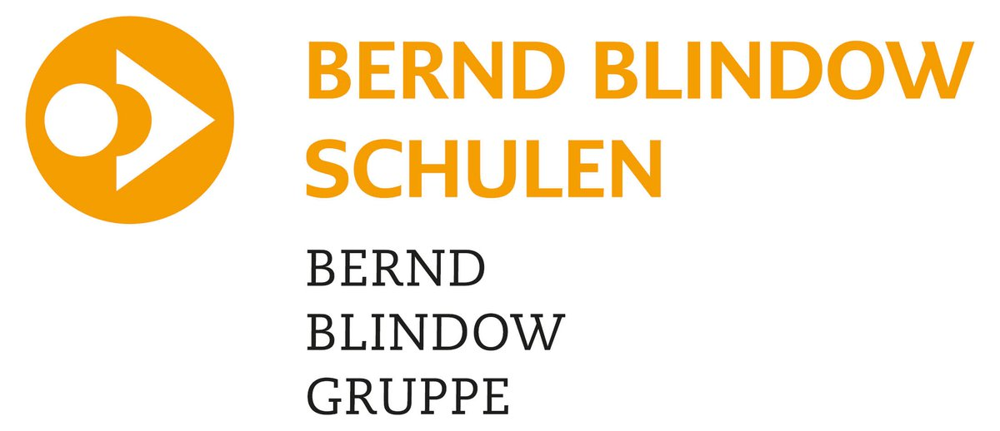
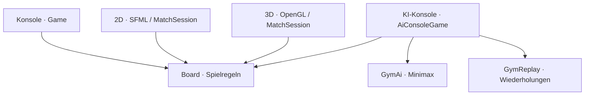

# Vier Gewinnt | Gym Edition – Technisches Projekt- und Codeprotokoll

 &nbsp;&nbsp;

> **Textfassung des 17-seitigen Projektprotokolls**, Stand 19.11.2026, Quellcommit `9df1faa3f3a8031bbe40e3267797a0f17e872772`.  
> Aus der bearbeitbaren Word-Datei übertragen. Die originale PDF-/Word-Gestaltung, eingebettete Diagramme und interne PDF-Sprungmarken sind in dieser Markdown-Fassung nicht vollständig enthalten.  
> [Repository](https://github.com/Julik527/vier-gewinnt-gym-edition-cpp) · [Aktuelle Architektur](../ARCHITECTURE.md) · [KI und Replay](../AI_REPLAY.md)

### Architektur auf einen Blick

JK AXIS | Vier Gewinnt – Technisches Projekt- und Codeprotokoll

BERND-BLINDOW-SCHULE RAVENSBURG   /   ITA 25/9

PROJEKTDOKUMENTATION  ·  C++17
VIER GEWINNT
GYM EDITION
Technisches Projekt- und Lernprotokoll
Architektur  •  Quellcode Schritt für Schritt  •  KI  •  2D/3D  •  GitHub  •  Tests

	
BERND-BLINDOW-SCHULE RAVENSBURG
Ausbildung: Informationstechnischer Assistent
Klasse: ITA 25/9  ·  Fach: Programmiertechnik
Autor laut Repository: Julian Krauß
Datum: 19. November 2026
	

QUELLSTAND
main  /  9df1faa3f3a8031bbe40e3267797a0f17e872772
GitHub-Repository öffnen

## Leseleitfaden
Dieses Dokument erklärt den tatsächlichen C++-Projektstand – nicht nur die Idee des Spiels. Die Reihenfolge geht vom Überblick über die Klassen zum konkreten Spielablauf und schließlich zu KI, VS Code und Qualitätssicherung.
Faktenbasis  Aktueller GitHub-Branch main, Commit 9df1faa3. Die beschriebenen Funktionen sind aus den jeweils genannten Quelldateien und Dokumenten abgeleitet.
Codebeispiele  Originalauszüge werden als solche gekennzeichnet. Ablaufbilder und vereinfachte Erklärungen dienen dem Verständnis und ersetzen nicht den Quellcode.
Prüfstatus  GitHub Actions für den genannten Commit wurden online geprüft; die persönliche Bedienung unter Windows, Audio und Bildschirmdarstellung auf dem Schul-PC sind gesonderte Abnahmeschritte.
Navigieren  Die Kapitelübersicht auf der nächsten Seite ist anklickbar. Das PDF besitzt außerdem Lesezeichen aus den Überschriften.

Abbildung 1 – Die vier Frontends und ihre gemeinsame Abhängigkeit von Board (eigene, quellcodebasierte Darstellung).

## Inhaltsübersicht
Klicke auf einen Eintrag, um direkt zum jeweiligen Kapitel zu springen. Die Links funktionieren auch im PDF-Export.
	  01  Projektsteckbrief und Zielsetzung
  02  Projektstruktur: Welcher Ordner wofür?
  03  Architektur: Trennung von Regeln und Oberflächen
  04  C++-Grundlagen direkt an deinem Projekt
  05  Board: Spielfeld und Schwerkraft
  06  Gewinnerkennung und Undo verstehen
  07  Die ursprüngliche Schulkonsole: Game und Menü
  08  ConsoleUI: die professionelle Textoberfläche
  09  Speichern, Laden und Highscores – GYM1
  10  SFML 2D: Wie die grafische Version arbeitet
  11  OpenGL 3D: Kamera, Raum und Mausklicks
  12  KI-Agent – Grundlagen und Schwierigkeitsstufen
  13  KI-Menü, Zustandsautomat und Match-Replay
  14  Build-System: CMake, Ninja und die vier Programme
  15  Fehlersuche: GDB, Pfad, Audio und Compiler
  16  Git und GitHub – verständlicher Arbeitsablauf
  17  Tests, GitHub Actions und tatsächliche Nachweise
  18  Lernweg: Das Projekt wirklich erklären können
  19  Quellen, Codepfade und Versionsnachweis
  20  Abschluss: Zusammenfassung und nächste Schritte

## 01 Projektsteckbrief und Zielsetzung
Das Projekt ist ein objektorientiertes Vier-Gewinnt-Spiel mit Gym-/Hantel-Thema. Die schulische Pflichtversion läuft in der Konsole; SFML-2D, OpenGL-3D und der KI-Spielagent sind eigenständige Erweiterungen. Der verbindende Bestandteil ist die Klasse Board.
	Merkmal
	Konkrete Ausprägung

	Sprache / Standard
	C++17; zusätzliche Python-Skripte für Tests und Build-Werkzeuge

	Repository
	Julik527/vier-gewinnt-gym-edition-cpp, Standardbranch main

	Schulkonsole
	2–4 Spieler, Menü, Regeln, Undo, Speichern/Laden, Highscores

	2D/3D
	SFML 3.1.0; 3D nutzt zusätzlich OpenGL

	KI-Modus
	2 Spieler: R (Mensch) gegen B (KI); Minimax und Replay

	Build/IDE
	CMake, Ninja oder andere Generatoren; VS Code mit vier F5-Profilen

	Abgabegrenze
	Die KI und grafischen Versionen sind nicht Teil der isolierten Schulabgabe

Lernziel  Du solltest erklären können, wie Eingaben validiert werden, warum Board unabhängig von der Oberfläche ist, wie Sieg und Speichern funktionieren und wie die vier Programme gebaut werden.
## 02 Projektstruktur: Welcher Ordner wofür?
Vereinfachte, geprüfte Verzeichnisstruktur aus main
vier-gewinnt-gym-edition-cpp/
  include/          Header: Klassen und Funktionsschnittstellen
  src/              C++-Implementierungen und Einstiegspunkte
    gui/            SFML, OpenGL, Eingabe, Grafik und Audio
  tests/            Unit-, Integrations- und Konfigurationstests
  assets/           Logos und optionale Audio-Assets
  docs/             Architektur, KI, Lern- und Testunterlagen
  scripts/          Prüf-, Build- und Release-Hilfen
  school/           Isolierte schulische Konsolenabgabe
  .vscode/          F5-Startprofile und Build-Aufgaben
  .github/workflows GitHub-Actions-Automatisierung
  CMakeLists.txt     Projekt-Buildbeschreibung
  README.md         Einstieg und Projektüberblick
	Datei
	Wofür du sie öffnest

	include/Board.h
	Schnittstelle und Daten des Spielfelds

	src/Board.cpp
	Schwerkraft, Drop, Undo und Gewinnerkennung

	include/Game.h + src/Game.cpp
	Ablauf der ursprünglichen Schulkonsole

	src/ConsoleUI.cpp
	Gerahmte und farbige Terminalansichten

	src/MatchSession.cpp
	GUI-unabhängiger Spielzustand für 2D und 3D

	src/GymAi.cpp
	Algorithmus des Computergegners

	src/ai_main.cpp
	KI-Hauptmenü, Spielerzug und Zustandswechsel

	src/AiConsoleUI.cpp
	KI-Menü, Spielanzeige und Ergebnisansichten

	src/GymReplay.cpp
	Rekonstruktion und Navigation von Zügen

	src/gui/Main.cpp / Main3D.cpp
	Fenster, Events, Darstellung

	CMakeLists.txt
	Welche Dateien zu welchem Programm gehören

	.vscode/launch.json / tasks.json
	F5-Profil und automatischer Build

## 03 Architektur: Trennung von Regeln und Oberflächen

Abbildung 2 – Programmstruktur (aus README, Architektur und tatsächlichen CMake-Zielen abgeleitet).
Der wichtigste Architekturgedanke heißt Separation of Concerns: Regeln, Steuerung und Darstellung sollen sich nicht gegenseitig unnötig vermischen.
Regelschicht  Board kennt Raster, zulässige Symbole, Schwerkraft, Zugrücknahme und Gewinnlinien. Sie benötigt weder SFML noch OpenGL.
Controller  Game steuert die Schulkonsole. MatchSession verwaltet die 2D/3D-Partie. AiConsoleGame steuert den KI-Konsolenmodus. Es existiert kein gemeinsamer übergreifender Controller für alle vier Programme.
Darstellung  ConsoleUI und AiConsoleUI erzeugen Terminalansichten. App (2D) und Arena3D (3D) zeichnen Fenster und reagieren auf Ereignisse.
Persistenz  Game und MatchSession können GYM1/Highscores schreiben. Die separate KI-Anwendung speichert dagegen nur eine Sitzungsbilanz im RAM.
Merke: Eine geänderte Farbe sollte idealerweise keine Änderung an hasWon() erfordern. Eine Änderung an der Gewinnregel sollte dagegen in Board zentral erfolgen.
## 04 C++-Grundlagen direkt an deinem Projekt
Header und Implementierung
Headerdateien (*.h) beschreiben, welche Klassen, Methoden und Daten von anderen Dateien verwendet werden können. Die Implementierung (*.cpp) enthält die Ausführung. Das Schlüsselwort #include bindet die Deklarationen ein.
Quellnaher Auszug – include/Board.h
// include/Board.h (gekürzt)
class Board {
public:
    explicit Board(int playerCount = 2);
    int nextFreeRow(int column) const;
    bool drop(int column, char symbol, int& rowPlaced);
    bool hasWon(int row, int column, char symbol) const;
};
class Board  Definiert einen eigenen Datentyp mit Eigenschaften und Methoden. Die privaten Werte grid_, rows_ und columns_ können von außen nicht beliebig verändert werden.
explicit  Verhindert unerwünschte implizite Umwandlungen in eine Board-Instanz.
const am Ende  Verspricht, den Zustand des Board-Objekts durch diese Methode nicht zu ändern.
int& rowPlaced  Referenzparameter: drop() schreibt die tatsächlich belegte Zeile zurück an den Aufrufer.
Datenstrukturen und Kontrollfluss
	C++-Element
	Wofür es hier gebraucht wird

	std::vector
	Dynamische Listen, z. B. Spielzüge, Spieler, Rasterzeilen

	std::map
	Zuordnung Spielername → Anzahl Siege

	enum class
	Eindeutige Zustände wie Screen oder AiLevel

	std::string
	Menü- und Namenseingaben

	std::pair<int,int>
	Koordinaten (Zeile, Spalte) einer Gewinnlinie

	std::filesystem
	Datei-/Ordnerpfade für Spielstände

	std::runtime_error
	Fehler melden, wenn ein erwarteter Zustand nicht eingehalten wird

Originalcode – src/ai_main.cpp
enum class Screen { Menu, Match, Result, Exit };
// ai_main.cpp: jeder Wert beschreibt eine Ansicht.
Frage für die Erklärung: Warum ist enum class sicherer als eine nichtssagende Zahl? Weil die Zustände benannt und typisiert sind.
## 05 Board: Spielfeld und Schwerkraft
Konstruktor und Rastergrößen
Originalauszug – src/Board.cpp
Board::Board(int playerCount)
    : rows_(rowCountForPlayers(playerCount)),
      columns_(rows_ + 1),
      grid_(rows_, vector<char>(columns_, '.')) {}
Schritt 1: Der Konstruktor berechnet die Zeilenzahl. Schritt 2: Die Spaltenzahl ist immer Zeilen + 1. Schritt 3: grid_ wird als zweidimensionaler Vektor vollständig mit Punkten als freien Zellen initialisiert.
	Spieler
	rows()
	columns()
	Raster

	2
	6
	7
	7 × 6

	3
	8
	9
	9 × 8

	4
	10
	11
	11 × 10

Einsteinwurf – vom Index bis ins Raster
Originalauszug – src/Board.cpp, sprachlich unverändert
int Board::nextFreeRow(int column) const {
    if (column < 0 || column >= columns_) return -1;
    for (int row = rows_ - 1; row >= 0; --row)
        if (grid_[row][column] == '.') return row;
    return -1;
}
1. Bereich prüfen  Ungültige Spalten werden mit -1 zurückgewiesen.
2. Unten beginnen  rows_ - 1 ist die unterste Rasterzeile. Die Schleife läuft nach oben.
3. Freies Feld suchen  Der erste Punkt wird zurückgegeben. Ist die Spalte voll, kommt -1.
Originalauszug – src/Board.cpp, verkürzte Formatierung
bool Board::drop(int column, char symbol, int& rowPlaced) {
    if (symbol != 'R' && symbol != 'B' &&
        symbol != 'G' && symbol != 'Y') {
        rowPlaced = -1;
        return false;
    }
    rowPlaced = nextFreeRow(column);
    if (rowPlaced == -1) return false;
    grid_[rowPlaced][column] = symbol;
    return true;
}
Wichtig  Eine fehlgeschlagene Eingabe ändert das Spielfeld nicht. Erfolgreiches drop() liefert true und die belegte Zeile.

Abbildung 3 – Logischer Ablauf. Im KI-Modus folgt nach einem gültigen menschlichen Zug automatisch die Computerentscheidung.
## 06 Gewinnerkennung und Undo verstehen
Vier Achsen prüfen
Auszug aus Board::hasWon(); die Achsenkommentare dienen der Erklärung
const int dr[4] = {0, 1, 1, 1};
const int dc[4] = {1, 0, 1, -1};
// horizontal, vertikal, diagonal ↘, diagonal ↙
for (int i = 0; i < 4; ++i) {
    int length = 1
        + countDirection(row, col, dr[i], dc[i], symbol)
        + countDirection(row, col, -dr[i], -dc[i], symbol);
    if (length >= 4) return true;
}
Die Methode zählt den zuletzt gesetzten Stein als 1 und sucht auf jeder Achse in beide Richtungen. So erkennt sie auch eine Viererreihe, bei der der letzte Stein mitten in der Reihe landet.
winningCells()  Gibt die Koordinaten der ersten gefundenen zusammenhängenden Gewinnlinie zurück. Sie können im Terminal oder der GUI farblich markiert werden.
undo(row,column)  Entfernt nur einen oben liegenden Stein aus seiner Spalte; ein Stein unter anderen Steinen darf nicht direkt verschwinden.
Grenzfall  hasWon() muss auf leeren oder ungültigen Feldern false liefern und darf über die Rastergrenzen nicht hinauslesen.
## 07 Die ursprüngliche Schulkonsole: Game und Menü
Startkette: main() → Game::run()
Auszug – src/main.cpp; Darstellung um Zeilenabstände gekürzt
int main() {
    try {
        Game game;
        game.run();
    } catch (const exception& ex) {
        cerr << "Programm beendet: " << ex.what() << '\n';
        return 1;
    }
    return 0;
}
main() ist nur der Einstiegspunkt. Game::run() enthält die Hauptmenüschleife. Wird eine Exception ausgelöst, endet das Programm kontrolliert mit Exitcode 1.
Menü und Spielschleife
Game::run() zeigt das Hauptmenü und reagiert auf die Auswahl 1–5 bzw. 0. Neue Partien werden in Game::newGame() angelegt; Game::play() läuft so lange, bis die Partie pausiert oder beendet wurde.
	Eingabe
	Bedeutung im normalen Konsolenspiel

	1
	Neues Spiel (2–4 Spieler und Namen festlegen)

	2
	Aktives Spiel fortsetzen

	3
	GYM1-Spielstand laden

	4
	Bestenliste

	5
	Anleitung/Regeln

	0
	Beenden (bei aktiver Runde mit Rückfrage)

Originalauszug – src/Game.cpp, Spielzugverarbeitung
int zeroCol = col - 1;
int landing = board_.nextFreeRow(zeroCol);
if (landing == -1) {
    cout << "Spalte ist voll. Erneut waehlen.\n";
    continue;
}
char symbol = players_[current_].getSymbol();
int row;
if (!board_.drop(zeroCol, symbol, row)) continue;
history_.push_back({row, zeroCol, current_});
Die äußere Eingabe ist für Menschen 1-basiert; der Vektorindex im Code ist 0-basiert. Deshalb wird genau einmal 1 abgezogen. Nach dem gültigen Einwurf wird die Zuggeschichte erweitert.
U / V / S / H / M  In Game::play() stehen unter anderem Undo, Vorschau (V 4), Speichern, Hilfe und Rückkehr ins Hauptmenü bereit.
Revanche  Die run-Schleife verarbeitet ein Rundenende ohne rekursiven Neustart. So wächst der Aufrufstack nicht mit jeder Revanche.
## 08 ConsoleUI: die professionelle Textoberfläche
ConsoleUI trennt die Darstellung von den Spielregeln. Die Funktionen erzeugen formatierten Text und console_ui::present() gibt ihn aus. Linien, Farben, Fortschrittsbalken und Gewinnmarkierungen sind Darstellung – nicht die Spiellogik.
Schnittstellen aus include/ConsoleUI.h, teils gekürzt
string mainMenu(const vector<Player>& players,
                const Board& board,
                bool active, int currentPlayer, int round);
string arena(const Board& board,
             const vector<Player>& players,
             int currentPlayer, int round,
             const map<string,int>& highscores, ...);
void present(const string& screen);
ANSI-Erkennung  Nur bei geeignetem Terminal werden Escape-Sequenzen für Farben und Bildschirmaktualisierung verwendet; mit NO_COLOR bleibt die Anzeige textbasiert.
Farben  Im Regelkern stehen R/B/G/Y als Spielsymbole. Die Oberfläche ordnet den Symbolen Farben zu.
Nicht destruktive Vorschau  Ein Vorschaustein wird nur beim Zeichnen eingeblendet; Board::drop() wird dabei nicht aufgerufen.
Einzelverantwortung  Wenn das Aussehen geändert werden soll, ist ConsoleUI in der Regel der richtige Einstieg und nicht Board.
## 09 Speichern, Laden und Highscores – GYM1
Aufbau der Speicherdatei
Die ursprüngliche Konsole und MatchSession verwenden die Dateien data/savegame.txt und data/highscore.txt. Das GYM1-Format enthält den Spielzustand als lesbaren Text.
Schematische Darstellung des GYM1-Formats; keine originale Spieldatei
GYM1
<spielerzahl> <aktueller_spieler> <zeilen> <spalten> <anzahl_zuege>
<name_1> <symbol_1>
...
<zeile> <spalte> <spielerindex>  (je Zug)
<rasterzeile_1>
...
Warum beim Laden ein Kandidaten-Board entsteht
Game::loadGame() prüft die Kennung GYM1, Größen, Spielernamen, Symbole, Zugreihenfolge und jede gespeicherte Rasterzeile. Die Züge werden auf einem frischen Board nachgespielt. Erst nach vollständig erfolgreicher Validierung werden die laufenden Variablen ersetzt.
Nachvollziehbarer Auszug – src/Game.cpp; Prüfblock ausgelassen
Board candidate(n);
// Namen und alle Zuege gegen candidate pruefen ...
board_ = std::move(candidate);
players_ = std::move(loadedPlayers);
history_ = std::move(loadedMoves);
writeSafely()  Schreibt zuerst eine eindeutige temporäre Datei, prüft den Stream und ersetzt anschließend den Zielpfad (unter Windows über MoveFileExW).
parseScores()  Liest die Highscores in eine temporäre std::map und übernimmt erst die vollständig validierten Werte.
Grenzen  Der Dateiersatz ist kein vollständiger Schutz vor Stromausfall oder gleichzeitigen Schreibzugriffen mehrerer Spielinstanzen. KI-Replay und KI-Bilanz nutzen diese Dateien nicht.
## 10 SFML 2D: Wie die grafische Version arbeitet
src/gui/Main.cpp enthält die Klasse App mit SFML-Fenster, Ereignisschleife, Menü, Buttons, Animation und Rendering. Die eigentlichen Partieregeln werden über MatchSession und Board gesteuert.
App erzeugt ein sf::RenderWindow (im Quellcode: 1280 × 800 Pixel).
Die Ereignisschleife liest Tastatur, Maus und Fensterereignisse.
Eine Menü- oder Spielfeldaktion wird in einen Programmzustand bzw. Spaltenindex umgesetzt.
Für einen Spielzug wird die Fallbewegung gezeigt; die echte MatchSession::drop()-Änderung erfolgt im vorgesehenen Moment.
Beim Zeichnen werden aktuelles Board, Spieler, Menüzustand, Farben und gegebenenfalls Audiozustand verwendet.

Abbildung 4 – Vom Nutzer bereitgestellter Windows-Screenshot der 2D-Menüoberfläche (19.11.2026). Sichtbar: „SCI-FI OGG 0/8 FEHLEN“.
MatchSession  Die Klasse hält Spielzustand, Spieler, Gewinnlinie, Undo und Dateifunktionen getrennt von SFML bereit. Dadurch lassen sich viele Regeln ohne Grafikfenster testen.
Audio  Die Oberfläche kann Audio steuern; die optionalen OGG-Dateien werden bewusst nicht vollständig im GitHub-Repository ausgeliefert.
## 11 OpenGL 3D: Kamera, Raum und Mausklicks
Die 3D-Anwendung kombiniert SFML (Fenster, Ereignisse, 2D-HUD) mit klassischen OpenGL-Zeichenfunktionen. Main3D.cpp enthält die Steuerung; Hilfs-Header kapseln 3D-Mathematik, Picking und Rendering.
	Datei / Bereich
	Aufgabe

	Main3D.cpp / Arena3D
	Fenster 1440 × 900, Spielzustände, Kamerabedienung und Render-Schleife

	Gym3DMath.h
	Vec3, dot/cross, Kamera-Basis, Projektion und Easing

	Gym3DPicking.h
	Bildschirmpixel → Raumstrahl → Schnittpunkt mit dem Brett → Spalte

	Gym3DRender.h
	Geometrische 3D-Grundformen und Kamerafunktionen

	MatchSession
	Gewinn, Spielerwechsel, Undo und Speichern unabhängig von der Grafik

Originalnaher Kern aus Gym3DPicking.h
const Vec3 ray = axes.forward
  + axes.right * ((pixel.x - centre.x) / scale)
  + axes.up * ((centre.y - pixel.y) / scale);
// Schnittpunkt aus Kameraposition + Strahl * Entfernung.
Die Funktion pickColumn() prüft, ob der Strahl parallel zur Brett-Ebene verläuft, ob der Schnittpunkt hinter der Kamera liegt und ob der Treffer innerhalb des wirklichen Spielfeldes liegt. Ein Wert von -1 bedeutet keinen gültigen Klick.
Wichtig für die Prüfung  3D-Grafik und 3D-Regeln sind nicht das Gleiche. Die Perspektive verändert, wie das Feld aussieht, aber nicht Board::hasWon().
## 12 KI-Agent – Grundlagen und Schwierigkeitsstufen
Der KI-Agent ist eine deterministische, regelbasierte Such-KI und kein trainiertes neuronales Netz. Er spielt auf einem 7×6-Brett gegen genau einen Menschen. Der Mensch setzt R, der Computer B.
	Stufe
	Konkreter Algorithmus
	Grenze

	Einfach
	Erste freie Spalte in Mittelpunkt-Reihenfolge [4,3,5,2,6,1,7]
	Keine Suchbaum-Optimierung

	Normal
	Minimax mit Alpha-Beta-Pruning, Suchtiefe 3
	Heuristik, kein garantiert optimales Spiel

	Schwer
	Minimax mit Alpha-Beta-Pruning, Suchtiefe 6
	Mehr Suchaufwand, weiterhin Heuristik

Originalzeile aus src/GymAi.cpp plus Erklärung
constexpr std::array<int, 7> kCenterFirst{{3, 2, 4, 1, 5, 0, 6}};
// Nullbasiert: Spalte 4, dann 3, 5, 2, 6, 1, 7.
Was Minimax macht
Für jede legale Computer-Spalte wird eine Kopie von Board erstellt.
Es wird simuliert, wie der Mensch bestmöglich antwortet.
Dies setzt sich abwechselnd fort, bis die festgelegte Suchtiefe oder ein Endzustand erreicht ist.
Die Bewertung bevorzugt günstige Viererfenster, die Brettmitte und unmittelbare Siege; gegnerische Drohungen erhalten negative Werte.
Der Computer wählt die Spalte mit dem besten Wert aus seiner Perspektive.

Abbildung 5 – Vereinfachte Minimax-Idee; Zahlen und Baumstruktur sind ein Lernbeispiel, keine reale Ausgabe von GymAi.
Warum Alpha-Beta-Pruning Zeit spart
Alpha ist die bisher beste bekannte Untergrenze für MAX, Beta die beste Obergrenze für MIN. Wenn alpha >= beta wird die weitere Suche in diesem Ast abgebrochen: Sie kann die Entscheidung der übergeordneten Knoten nicht mehr verbessern.
Originalauszug – src/GymAi.cpp
if (maximizing) {
    if (value > best) best = value;
    if (best > alpha) alpha = best;
} else {
    if (value < best) best = value;
    if (best < beta) beta = best;
}
if (alpha >= beta) break;
Spezielle Abkürzungen  Vor Minimax prüft chooseAiMove(), ob die KI sofort gewinnen kann. Anschließend prüft sie, ob ein direkter menschlicher Gewinn blockiert werden muss.
Sicherheit  chooseAiMove() lehnt andere Brettgrößen, ungültige Symbole oder bereits abgeschlossene Partien ab. Das übergebene Board wird nicht verändert.
## 13 KI-Menü, Zustandsautomat und Match-Replay
Die vier KI-Bildschirmzustände
Originalzeile – src/ai_main.cpp
enum class Screen { Menu, Match, Result, Exit };
AiConsoleGame steuert anhand von Screen die nächste Ansicht. Das neue KI-Hauptmenü hat eigene Ansichten für Schwierigkeitswahl, Spielernamen, Regeln, Bilanz und Replay. AiConsoleUI erzeugt die Texte; AiConsoleGame verarbeitet die Eingaben.
	Menüpunkt
	Aktion

	01
	Neues KI-Duell

	02
	Laufendes Duell fortsetzen

	03
	KI-Schwierigkeit wählen

	04
	Spielernamen ändern

	05
	Anleitung

	06
	Trainingsbilanz

	07
	Letzte Partie im Replay ansehen

	00
	Beenden

Ein menschlicher und ein KI-Zug im Code
Originalauszug – src/ai_main.cpp
const int column = action[0] - '1';
if (!put(column, 'R')) {
    notice_ = "Spalte voll. Bitte andere Spalte waehlen.";
    continue;
}
if (!active_) return Screen::Result;
const auto choice = gym::chooseAiMove(board_, 'B', roundLevel_);
if (choice.column < 0 || !put(choice.column, 'B'))
    throw std::runtime_error("KI konnte keinen legalen Zug setzen.");
Ablauf: Mensch wählt eine Spalte → put() setzt R → Sieg/Remis wird geprüft → nur bei aktiver Partie wird chooseAiMove() aufgerufen → die KI setzt B → danach beginnt der nächste menschliche Zug.
Replay = Zustände rekonstruieren, nicht neu würfeln
GymReplay erhält die Folge der Spaltenindizes. Es erstellt zuerst ein leeres Board und speichert nach jedem legalen Zug einen Snapshot. Mit N/P bewegt sich ein Cursor vorwärts oder rückwärts durch diese bereits berechneten Zustände.
Originalauszug – src/GymReplay.cpp
bool MatchReplay::next() {
    if (cursor_ + 1 >= snapshots_.size()) return false;
    ++cursor_;
    return true;
}
bool MatchReplay::previous() {
    if (cursor_ == 0) return false;
    --cursor_;
    return true;
}
Bedienung  Im Duell 1–7, V4, H und M. Beim Replay N, P und Q. Nach Spielende Revanche, Stufenwechsel, Replay oder Hauptmenü.
Einschränkung  Der KI-Modus hat keine persistente Highscore- oder GYM1-Anbindung. Nach Programmende gehen Replay und Sitzungsbilanz verloren.
## 14 Build-System: CMake, Ninja und die vier Programme
CMake beschreibt in CMakeLists.txt, aus welchen Quelldateien Programme und Bibliotheken entstehen. Der eigentliche Compiler ist z. B. g++; Ninja arbeitet einen von CMake erstellten Build-Plan ab. CTest führt registrierte Tests aus.
CMakeLists.txt – einzelne originale add_executable-Zeilen zusammengefasst
# CMake-Konzept: vier Ziele, unterschiedliche Abhaengigkeiten
add_executable(vier-gewinnt src/main.cpp src/Game.cpp src/ConsoleUI.cpp)
add_executable(vier-gewinnt-gui src/gui/Main.cpp)
add_executable(vier-gewinnt-3d src/gui/Main3D.cpp)
add_executable(vier-gewinnt-ki src/ai_main.cpp)
	Variante
	Build-Schalter
	EXE unter Windows/Ninja

	Konsole
	Standard
	vier-gewinnt.exe

	2D
	GYM_BUILD_GUI=ON
	build-gui/vier-gewinnt-gui.exe

	3D
	GYM_BUILD_3D=ON
	build-3d/vier-gewinnt-3d.exe

	KI
	GYM_BUILD_AI=ON
	build-ai/vier-gewinnt-ki.exe

Praxis: alle vier Versionen mit VS Code F5
Datei → Ordner öffnen → C:\Dev\GymEdition. Der Ordner muss im bestehenden VS-Code-Fenster als Workspace geöffnet sein.
Links Ausführen und Debuggen wählen (Strg + Umschalt + D).
Im Dropdown Konsole, 2D, 3D oder KI-Agent wählen.
F5 drücken. Die passende preLaunchTask konfiguriert bzw. baut die Anwendung und startet danach die EXE.
Beim ersten 2D-/3D-Build müssen MSYS2 UCRT64, CMake, Ninja und zusätzliche SFML-Abhängigkeiten verfügbar sein.
Originalinhalt – .vscode/settings.json
// .vscode/settings.json (unverändert)
{
  "terminal.integrated.cwd": "${workspaceFolder}",
  "terminal.integrated.defaultProfile.windows": "PowerShell",
  "git.autofetch": true
}
Warum kein cd?  ${workspaceFolder} verweist auf den aktuell in VS Code geöffneten Ordner. Neue integrierte Terminals starten dort. Bereits geöffnete Terminals werden nicht nachträglich versetzt.
Warum GitHub-Autofetch nicht Pull ist  git.autofetch ruft Remote-Metadaten ab; es führt nicht automatisch Commits, Pull oder Push aus.
## 15 Fehlersuche: GDB, Pfad, Audio und Compiler
GDB -environment-cd: „No such file or directory“
Dein Windows-Screenshot zeigt, dass VS Code bzw. GDB den alten Ordner unter C:\Users\Alexander Krauß\Documents\GitHub verwendet. Der Ordner enthält ß; zusätzlich war der vom Debugger verwendete Pfad nicht verfügbar. Ein cd in irgendeiner PowerShell verschiebt nicht das geöffnete VS-Code-Workspace.
Empfohlener Windows-Ablauf; zuerst prüfen, dass die Projektkopie vorhanden ist
code --reuse-window "C:\Dev\GymEdition"
git -C C:\Dev\GymEdition status -sb
# Im VS-Code-Fenster: Ausführen und Debuggen → F5
Sicherheitsregel  Nicht den alten Ordner und die .git-Historie löschen. Nicht reset --hard ausführen. Vor einem Pull lokale Änderungen sichern bzw. bewusst wiederherstellen.
OGG-Musik: „SCI-FI OGG 0/8 FEHLEN“
Der Screenshot zeigt eine tatsächlich gestartete 2D-Anwendung, aber fehlende optionale Musikdateien. Das ist ein Assets-Problem, kein Hinweis auf defekte C++-Spielregeln. Die OGG-Dateien werden bewusst nicht als normales Source-Asset mitversioniert.
Beispiel: nur ausführen, wenn ogg.zip tatsächlich heruntergeladen wurde
Test-Path C:\Dev\GymEdition\ogg.zip
# Falls das originale Audioarchiv vorhanden ist:
python scripts/install-sci-fi-audio.py --zip .\ogg.zip
python scripts/install-sci-fi-audio.py --verify
Ninja: no work to do
Diese Meldung heißt: Nach dem Abgleich der Eingabe- und Ausgabedateien muss aktuell nichts neu gebaut werden. Sie belegt nicht automatisch, dass jedes GUI-Element oder die Audioausgabe korrekt funktioniert.
## 16 Git und GitHub – verständlicher Arbeitsablauf
Git verwaltet Versionen lokal. GitHub speichert und organisiert das Remote-Repository. VS Code ist die Entwicklungsumgebung und zeigt Git-Funktionen als Oberfläche an.
	Begriff
	Bedeutung

	Arbeitsverzeichnis
	Deine lokalen Dateien in C:\Dev\GymEdition

	Commit
	Ein protokollierter Stand im lokalen Git

	Branch
	Entwicklungszweig, z. B. main oder feature/...

	origin
	Name des verbundenen GitHub-Remotes

	Fetch
	Remote-Informationen abrufen, ohne den eigenen Code zusammenzuführen

	Pull
	Remote-Änderungen holen und lokal integrieren

	Push
	Eigene Commits auf GitHub hochladen

	Pull Request
	Änderungsvorschlag zur Prüfung und kontrollierten Übernahme

Praxis: sicher synchronisieren ohne cd
Windows PowerShell – jederzeit aus einem anderen Verzeichnis möglich
git -C C:\Dev\GymEdition status -sb
git -C C:\Dev\GymEdition remote -v
git -C C:\Dev\GymEdition pull --ff-only
Auf deiner Arbeitskopie wurde zuvor eine gelöschte Datei assets/audio/sci-fi/README.md angezeigt. Prüfe das in der VS-Code-Quellcodeverwaltung, bevor du einen neuen Commit erstellst. Ein leerer Arbeitsordner und eine bestehende .git-Verbindung sind keine austauschbaren Zustände.
Code ändern und lokal speichern.
In VS Code Strg + Umschalt + G: Diff prüfen, nur beabsichtigte Dateien stagen.
Aussagekräftige Commit-Nachricht schreiben und committen.
Falls nötig erst Pull (oder Konflikte bewusst auflösen), danach Push.
Für riskante Umbauten separaten Branch und Pull Request einsetzen.
## 17 Tests, GitHub Actions und tatsächliche Nachweise
Für den konkret geprüften Commit 9df1faa3 sind in den aktuellen main-Workflow-Läufen alle drei relevanten Statusanzeigen auf „success“. Das ist ein echter, auf GitHub abgefragter CI-Status; keine frei geschätzte Testnote.
	Workflow
	GitHub-Ergebnis
	Evidenz

	School Console Only | Build & Acceptance
	success
	Run 44511568750

	Document Checks
	success
	Run 44511568684

	C++ Build and Tests
	success
	Run 44511568732

Unit-Tests  Beispiele: board_tests.cpp, ai_replay_tests.cpp, ai_console_ui_tests.cpp und scene3d_tests.cpp prüfen einzelne Funktionen bzw. Zustände.
Integrationstests  integration_smoke.py und ai_console_flow_test.py füttern Programme mit Eingaben und kontrollieren Ausgaben, Menüs und Fehlerfälle.
Konfigurationstest  vscode_config_test.py kontrolliert statisch, ob F5-Profile, preLaunchTasks, Dateipfade und CMake-Ziele zusammenpassen.
CI-Grenzen  Ein grüner Workflow beweist nicht den lokalen GDB-Start auf deinem Rechner, den Klang der OGG-Dateien, das Rendering auf einem Schulbeamer oder vollständige Partien per Maus.
Konkretes Abnahmeprotokoll für deinen PC
	Test-ID
	Prüfung
	Status

	P01
	VS Code öffnet C:\Dev\GymEdition im selben Fenster
	Offen (lokal)

	P02
	Alle vier F5-Profile bauen und starten
	Offen (lokal)

	P03
	Konsole: 2 Spieler, Gewinn, Undo, Speichern/Laden
	Offen (lokal)

	P04
	KI: 3 Stufen, Sieg/Blockade, Pause und Replay
	Offen (lokal)

	P05
	2D/3D: Fenster, Klick, Animation, Revanche
	Offen (lokal)

	P06
	Audio: acht OGG-Dateien verifiziert und hörbar
	Offen (Assets fehlen)

	P07
	GitHub main: C++/Docs/Schulkonsole Actions
	Erfolgreich, SHA 9df1faa3

Diese Tabelle darf nach Durchführung der manuellen Tests ergänzt werden. Eine erfolgreiche CI wird bewusst nicht als bestandene persönliche Abnahme ausgegeben.
## 18 Lernweg: Das Projekt wirklich erklären können
60 Minuten – erster Gesamtdurchlauf
10 Min: CMakeLists.txt und README ansehen. Benenne die vier EXEs und ihre Startdateien.
15 Min: Board.h/Board.cpp lesen. Zeichne Raster und erkläre Schwerkraft, hasWon und undo.
15 Min: Game.cpp ansehen. Folge einer Menüwahl und einem gültigen Zug.
10 Min: GymAi.cpp ansehen. Erkläre Suchtiefe, Minimax und Alpha-Beta ohne Formeln auswendig zu lernen.
10 Min: F5-Profil starten und git status prüfen; Unterschiede zwischen lokalen und Remote-Daten erklären.
Acht typische Fachgespräch-Fragen mit Kurzantworten
Warum gibt es Board.h und Board.cpp?
Der Header definiert die Schnittstelle, die CPP-Datei die implementierten Regeln.
Warum beginnt col mit col - 1?
Menschen wählen 1–7, der Vektor nutzt Indizes 0–6.
Wie bleibt ein ungültiger Zug unverändert?
Board::drop prüft Symbol und Platz, bevor grid_ beschrieben wird.
Wie erkennt hasWon eine diagonale Linie?
Für beide Diagonalen wird in Vorwärts- und Rückwärtsrichtung gezählt.
Was passiert bei Undo?
Nur der oberste Stein einer Spalte wird entfernt, die Historie angepasst.
Was unterscheidet Game und MatchSession?
Game steuert die Schulkonsole; MatchSession den GUI-unabhängigen Zustand der Grafikversionen.
Ist dein KI-Agent ein neuronales Netz?
Nein. Er benutzt feste Regeln, Minimax, Alpha-Beta und eine Bewertungsfunktion.
Wieso funktioniert F5 manchmal nicht trotz erfolgreichem Build?
Debugger/Workspace/PATH können fehlerhaft sein; Compile-Erfolg und Debug-Start sind getrennte Schritte.
## 19 Quellen, Codepfade und Versionsnachweis
Alle Links beziehen sich auf den geprüften Commit. Dadurch bleiben sie auch nach späteren Änderungen an main reproduzierbar.
Repository-Übersicht
README.md
CMakeLists.txt
Board.h
Board.cpp
Game.cpp
ConsoleUI.cpp
MatchSession.cpp
GymAi.cpp
ai_main.cpp
AiConsoleUI.cpp
GymReplay.cpp
3D-Picking
VS-Code-Debug-Profile
VS-Code-Build-Aufgaben
Architekturdokument
KI-Dokumentation
C++-CI-Lauf
Dokumentations-CI-Lauf
Schulkonsole-CI-Lauf
Medien-/Logoquellen: JK AXIS und Bernd-Blindow-Logo aus dem zuvor vom Nutzer bereitgestellten JK_AXIS_Designsystem_V3_13_1-Paket. Der eingebundene 2D-Screenshot wurde vom Nutzer in dieser Unterhaltung bereitgestellt. Die technischen Ablaufdiagramme wurden für dieses Protokoll nach dem Quellcode erstellt.
## 20 Abschluss: Zusammenfassung und nächste Schritte
Das Projekt ist für den Unterricht gut anhand einer klaren Kette erklärbar: Benutzeraktion → Controller → Board-Regel → Spielzustand → Ansicht. Besonders hilfreich sind die strikte Zugvalidierung, die Wiederverwendung von Board und die unabhängige KI-Implementierung.
Bereits belegt  Vier CMake-Ziele und vier F5-Profile existieren in main. Die zum Commit 9df1faa3 gehörenden GitHub-Actions-Läufe für C++, Dokumentation und Schulkonsole sind erfolgreich.
Noch nicht belegt  Fehlerfreier Start aller vier F5-Profile auf dem konkreten Windows-PC, OGG-Audio und vollständiger manueller GUI-/3D-Test.
Sicherer nächster Schritt  Lokal C:\Dev\GymEdition in VS Code als Workspace öffnen, Git-Änderungen prüfen, Pull ausführen und nacheinander Konsole, KI, 2D und 3D starten. Ergebnisse im Abnahmeprotokoll eintragen.
Aktuelles GitHub-Repository
JK AXIS  |  Codeprotokoll  |  Seite  von
